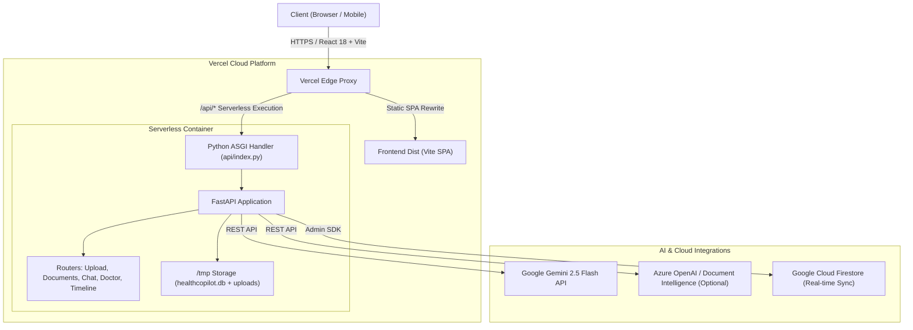

# MED DEV COPILOT — AI-Powered Personal Health Records & Clinical Copilot

[](https://med-dev-copilot.vercel.app/)
[](https://fastapi.tiangolo.com)
[](https://react.dev)
[](https://www.typescriptlang.org)
[](https://ai.google.dev/)
[](https://firebase.google.com/)

> **Transforming fragmented medical paperwork, handwritten prescriptions, and diagnostic lab reports into clear, structured, and empathetic patient insights.**

---

## 🌐 Live Website

- **Production URL**: [https://med-dev-copilot.vercel.app/](https://med-dev-copilot.vercel.app/)
- **Interactive API Documentation**: [https://med-dev-copilot.vercel.app/api/docs](https://med-dev-copilot.vercel.app/api/docs)
- **Health Check**: [https://med-dev-copilot.vercel.app/api/health](https://med-dev-copilot.vercel.app/api/health)

---

## 💡 Overview & Problem Statement

Every year, millions of patients walk away from hospitals and clinics clutching crumpled prescriptions, complex diagnostic reports, and discharge summaries filled with intimidating clinical abbreviations and pharmaceutical jargon. 

**MED DEV COPILOT** bridges the gap between clinicians and patients through an end-to-end healthcare platform that:
1. **Digitizes & Organizes**: Converts physical papers, xerox copies, and PDFs into an organized personal **DigiLocker Drive**.
2. **Translates Jargon**: Employs **Google Gemini 2.5 Flash** and **Azure AI** to generate plain-language explanations at an 8th-grade reading level in English, Hindi, Telugu, and Tamil.
3. **Empowers Doctors**: Offers a dedicated **Doctor Clinical Station** with automated SOAP note transcription (Subjective, Objective, Assessment, Plan) and clinical record review.
4. **Maintains Continuity**: Builds a chronological health timeline, flags abnormal lab biomarkers, and exports standard **FHIR R4 JSON bundles** compliant with India's Ayushman Bharat Digital Mission (ABDM / ABHA).

---

## ✨ Key Features

### 📁 1. Patient DigiLocker Drive
- **Intelligent Folders**: Automatically organizes files into `Prescriptions`, `Lab Reports`, `Scans & Xerox Copies`, `Discharge Summaries`, and `Insurance`.
- **Camera & Webcam Scanner**: Built-in camera capture modal allows patients to snap photos of physical prescriptions directly from their laptop or phone.
- **Xerox & Thermal Paper Preservation**: Dedicated detection and contrast optimization for faded thermal paper and photocopies.
- **Smart Tagging & Search**: Fast search across extracted medicines, doctors, hospital names, and dates.

### 🧠 2. AI Document Intelligence & Extraction
- **Multimodal AI Pipeline**: Combines pure-Python PDF extraction (`pypdf`), OCR, and Google Gemini 2.5 Flash.
- **Structured Clinical Extraction**: Automatically extracts:
  - 💊 **Medications**: Name, dosage, frequency (OD, BD, TID), duration, route, and timing instructions.
  - 🧪 **Lab Biomarkers**: Test name, numerical value, reference ranges, and visual abnormality badges (`High`, `Low`, `Normal`).
  - 🩺 **Diagnoses & Conditions**: Clinical terms mapped to plain-language descriptions.
  - ⚠️ **Critical Warnings**: Drug interactions, allergy warnings, and urgent follow-up milestones.
- **Multi-Language Health Summaries**: Plain-language explanations in **English**, **Hindi (हिंदी)**, **Telugu (తెలుగు)**, and **Tamil (தமிழ்)**.

### 🩺 3. Dual-Portal Architecture: Doctor Clinical Station
- **Role Switcher**: Seamlessly switch between **Patient Drive** and **Doctor Clinical Station**.
- **Patient Directory**: Clinicians can search patients, view complete longitudinal records, and read extracted findings.
- **AI Clinical Voice & Note Transcriber**: Converts rough clinical thoughts or dictated voice transcripts into structured **SOAP notes**:
  - `Subjective`: Chief complaints and symptom history.
  - `Objective`: Vitals, physical examination, and lab results.
  - `Assessment`: Clinical diagnosis and progress notes.
  - `Plan`: Medications, dosage changes, and scheduled tests.
- **Direct Clinician Advice**: Doctors can write notes and advice directly into the patient's record.

### 💬 4. Conversational Health Companion (Chatbot)
- **Dual Presentation**: Accessible as a full-page chat (`/chat`) and a floating widget (`ChatWidget`) across all screens.
- **Voice Text-to-Speech (TTS)**: Patients can listen to explanations aloud with an integrated speech synthesizer.
- **One-Click Copy & Follow-Up Chips**: Provides immediate answers to questions about medication timing, dietary precautions, and test interpretations.
- **Clinician Communication**: Doctors can send direct advice to patients through the chat channel.

### ⏱️ 5. Chronological Health Timeline & ABHA Profile
- **Timeline Engine**: Groups doctor visits, prescription changes, and lab tests into a single historical timeline.
- **ABHA ID Integration**: Mock Ayushman Bharat Health Account (ABHA ID) generation and profile linking (`91-XXXX-XXXX-XXXX`).
- **FHIR R4 Export**: Generates compliant HL7/FHIR R4 DiagnosticReport, MedicationRequest, and Condition JSON bundles for nationwide interoperability.

---

## 🏗️ System Architecture



### End-to-End Processing Flow

```
1. File Upload (PDF / PNG / JPG / TXT)
   │
   ▼
2. FastAPI (/api/upload) validates format & stores in /tmp/uploads
   │
   ▼
3. Extraction Service:
   ├── pypdf / OCR parses raw text
   └── Gemini 2.5 Flash extracts structured JSON (Medications, Labs, Diagnoses)
   │
   ▼
4. Plain-Language Summary Engine:
   └── Generates structured 4-section summary in patient's preferred language
   │
   ▼
5. Persistence & Sync:
   ├── Stored in SQLite (/tmp/healthcopilot.db)
   ├── Synced to Cloud Firestore
   └── Generates Timeline Events & ABHA Profile updates
   │
   ▼
6. Frontend updates instantly with extracted tables, interactive cards & timeline
```

---

## 🛠️ Tech Stack

| Layer | Technologies Used | Description |
|---|---|---|
| **Frontend** | React 18, TypeScript, Vite, Tailwind CSS | High-contrast, polished blue-and-white healthcare UI |
| **Icons & Motion** | Lucide React, CSS Transitions | Clean medical iconography and micro-animations |
| **Backend API** | FastAPI, Pydantic v2, Uvicorn | High-performance Python ASGI RESTful API |
| **Database** | SQLite + `aiosqlite`, PostgreSQL + `asyncpg` | Dual asynchronous SQL engine with auto-migrations |
| **Cloud Sync** | Google Cloud Firestore (`firebase-admin`) | Real-time multi-device database synchronization |
| **Generative AI** | Google Gemini 2.5 Flash (`google-genai`) | Clinical extraction, summarization, and interactive chat |
| **Document Processing** | `pypdf`, `Pillow`, `python-multipart` | Serverless-compatible in-memory document parsing |
| **Hosting & Deploy** | Vercel Serverless Functions (`@vercel/python`) | Global edge CDN + Python serverless execution |
| **Interoperability** | HL7 FHIR R4, Ayushman Bharat (ABHA) | Standardized healthcare data export |

---

## 📡 API Reference

Interactive Swagger documentation is available at `/api/docs` or `/docs`.

| Method | Endpoint | Description |
|---|---|---|
| `GET` | `/api/health` | Health check endpoint returning database connection status |
| `POST` | `/api/upload` | Upload and process medical document (PDF, PNG, JPG, TXT) |
| `GET` | `/api/documents` | Retrieve all documents for the authenticated patient |
| `GET` | `/api/documents/{id}` | Get full document details, OCR text, and AI health summary |
| `POST` | `/api/documents/{id}/reprocess` | Re-run AI extraction in a different language |
| `DELETE`| `/api/documents/{id}` | Remove a document and its associated records |
| `GET` | `/api/timeline` | Fetch chronological medical events and lab history |
| `GET` | `/api/patients/me` | Fetch current patient profile and linked ABHA ID |
| `PATCH`| `/api/patients/me` | Update profile information and preferred language |
| `GET` | `/api/patients/me/fhir` | Export full medical history as HL7 FHIR R4 JSON bundle |
| `GET` | `/api/drive/folders` | Get folder structure and document counts |
| `GET` | `/api/drive/documents` | Query documents by folder, tag, or xerox status |
| `GET` | `/api/doctor/patients` | Retrieve list of all patient records for clinical review |
| `POST` | `/api/doctor/transcribe` | Convert voice or rough text into structured SOAP notes |
| `POST` | `/api/doctor/insights` | Create a verified doctor note / clinical advice |
| `GET` | `/api/chat/messages` | Get health companion conversation history |
| `POST` | `/api/chat/send` | Send question to AI Companion with Gemini 2.5 Flash response |
| `POST` | `/api/chat/doctor-reply` | Doctor sends a verified reply to a patient's query |

---

## 🚀 Getting Started Locally

### Prerequisites
- **Node.js**: v18.0 or higher
- **Python**: v3.11 or higher
- **Git**

### Option A: One-Click Quickstart (Windows)

Simply double-click or run:
```powershell
.\start-dev.ps1
```
or
```cmd
start-dev.bat
```
This script cleans port conflicts, starts the FastAPI backend on port `8000`, and launches the Vite frontend on port `5173`.

---

### Option B: Manual Setup

#### 1. Clone the Repository
```bash
git clone https://github.com/Tazeemhub/Life-LAIne.git
cd Life-LAIne
```

#### 2. Backend Setup
```bash
cd backend

# Create and activate Python virtual environment
python -m venv venv
# On Windows:
.\venv\Scripts\activate
# On Mac/Linux:
# source venv/bin/activate

# Install dependencies
pip install -r requirements.txt

# Create .env file (leave AI keys empty for zero-config mock mode)
copy .env.example .env

# Run FastAPI server
uvicorn app.main:app --port 8000 --reload
```
The API will be live at `http://localhost:8000` (Docs: `http://localhost:8000/docs`).

#### 3. Frontend Setup
```bash
cd ../frontend

# Install dependencies
npm install

# Start development server
npm run dev
```
The web application will open at `http://localhost:5173`.

---

## ⚙️ Environment Variables

Create a `.env` file in the `backend/` directory or project root.

```ini
# Application
ENVIRONMENT=development
STORAGE_PATH=./uploads

# Database (Default: SQLite local database; or use PostgreSQL)
DATABASE_URL=sqlite+aiosqlite:///./healthcopilot.db

# Google Gemini API (Recommended for production AI summaries & Chat)
GEMINI_API_KEY=your_gemini_api_key_here
GEMINI_MODEL=gemini-2.5-flash
USE_GEMINI=true

# Google Cloud Firestore (Optional - for real-time cloud sync)
USE_FIREBASE=false
FIREBASE_PROJECT_ID=your-project-id
FIREBASE_CREDENTIALS_PATH=./serviceAccountKey.json

# Azure OpenAI & Document Intelligence (Optional alternative)
USE_AZURE_OPENAI=false
AZURE_OPENAI_ENDPOINT=https://your-resource.openai.azure.com/
AZURE_OPENAI_API_KEY=your_azure_key
AZURE_DOCUMENT_INTELLIGENCE_ENDPOINT=https://your-resource.cognitiveservices.azure.com/
AZURE_DOCUMENT_INTELLIGENCE_KEY=your_doc_intel_key
```

> **Note on Zero-Config Mode:** If no AI keys are provided, the platform automatically utilizes built-in clinical mock intelligence, allowing full local development and evaluation without third-party API accounts.

---

## ☁️ Deployment on Vercel

The repository includes a production-ready configuration for Vercel with zero required container setup.

1. Push your repository to GitHub.
2. Import the project into [Vercel](https://vercel.com).
3. Set the Framework Preset to **Vite** and Root Directory to **`.`** (project root).
4. In Project Settings, add any environment variables (e.g. `GEMINI_API_KEY`).
5. Click **Deploy**.

Vercel automatically:
- Builds the React frontend via `npm run build` to `frontend/dist`.
- Installs Python dependencies from root `requirements.txt`.
- Deploys `api/index.py` as a high-performance Python Serverless Function with routes mapped in `vercel.json`.

---

## 🛡️ Medical Safety & Disclaimers

1. **Non-Diagnostic Tool**: MED DEV COPILOT is an informational assistive tool designed to improve patient health literacy. It **does not** provide medical diagnoses or replace licensed clinical judgment.
2. **Prominent Disclaimers**: Every AI-generated summary, extracted lab table, and chatbot reply includes clear medical disclaimers directing patients to consult qualified physicians.
3. **Low-Confidence Warnings**: Extractions with model confidence scores below 70% are visually flagged with warning indicators urging manual verification.
4. **Data Privacy**: No patient health data is shared with public third-party models; all inference adheres to private, enterprise-grade AI endpoints.

---

## 📂 Project Directory Structure

```
MED-DEV-1/
├── api/
│   ├── index.py                    # Vercel Serverless Function entrypoint
│   └── requirements.txt            # Serverless runtime dependencies
├── backend/
│   ├── app/
│   │   ├── models/
│   │   │   ├── domain.py           # SQLAlchemy database models
│   │   │   └── schemas.py          # Pydantic request/response schemas
│   │   ├── routers/
│   │   │   ├── upload.py           # Document upload & serverless inline extraction
│   │   │   ├── documents.py        # Document list, detail, and reprocess
│   │   │   ├── drive.py            # DigiLocker folders, tags & xerox flags
│   │   │   ├── doctor.py           # Doctor patient directory & SOAP transcription
│   │   │   ├── chat.py             # Health companion multi-turn chat
│   │   │   ├── timeline.py         # Longitudinal clinical events
│   │   │   └── patients.py         # ABHA ID profile & FHIR bundle generator
│   │   ├── services/
│   │   │   ├── gemini_service.py   # Google Gemini 2.5 Flash integration
│   │   │   ├── extraction.py       # Core document processing pipeline
│   │   │   ├── document_intelligence.py # PDF (pypdf) & OCR text extraction
│   │   │   ├── blob_storage.py     # Local /tmp and Azure Blob file storage
│   │   │   ├── firebase_service.py # Firestore real-time database sync
│   │   │   └── fhir.py             # HL7 FHIR R4 bundle builder
│   │   ├── config.py               # Pydantic BaseSettings environment manager
│   │   ├── database.py             # Async database engine & /tmp SQLite management
│   │   └── main.py                 # FastAPI application factory
│   └── requirements.txt
├── frontend/
│   ├── src/
│   │   ├── components/
│   │   │   ├── Navbar.tsx          # Brand header & portal navigation
│   │   │   ├── UploadZone.tsx      # Drag-and-drop file upload zone
│   │   │   ├── CameraScanModal.tsx # Live webcam scanner for paper documents
│   │   │   ├── ChatWidget.tsx      # Floating AI Companion with Text-to-Speech
│   │   │   ├── TimelineComponent.tsx # Interactive health timeline
│   │   │   ├── HealthSummaryCard.tsx # Plain-language AI explanation card
│   │   │   ├── ExtractedFieldsPanel.tsx # Medications, labs & diagnoses tables
│   │   │   └── DocumentCard.tsx    # File card with status badges
│   │   ├── pages/
│   │   │   ├── Home.tsx            # Landing page
│   │   │   ├── PatientDrive.tsx    # DigiLocker folder drive
│   │   │   ├── DoctorPortal.tsx    # Clinical station & SOAP note transcriber
│   │   │   ├── Chat.tsx            # Full conversational health companion
│   │   │   ├── Timeline.tsx        # Longitudinal health records
│   │   │   ├── Profile.tsx         # ABHA ID card & FHIR exporter
│   │   │   └── Login.tsx           # Dual-portal role switcher
│   │   ├── lib/
│   │   │   ├── api.ts              # Axios HTTP client
│   │   │   └── store.ts            # Zustand global state store
│   │   └── index.css               # Polished blue, white & near-black styles
│   ├── index.html                  # HTML entrypoint with metadata
│   └── package.json
├── samples/                        # Sample clinical documents for testing
├── requirements.txt                # Root requirements for Vercel Python runtime
├── vercel.json                     # Vercel serverless functions & SPA routing configuration
└── README.md
```

---

## 📄 License

This project is licensed under the MIT License — see the [LICENSE](LICENSE) file for details.
