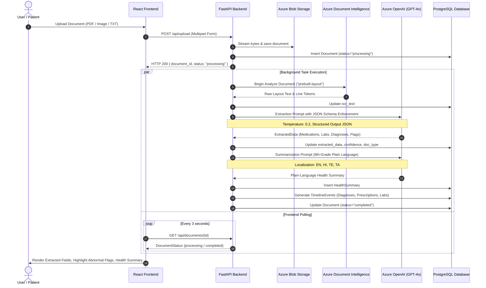
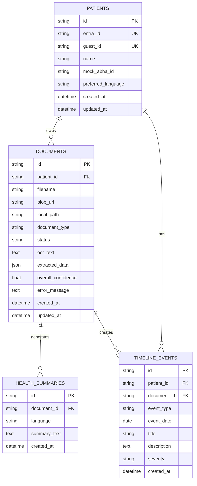

# Technical Architecture: AI-Powered Personal Health Copilot

> **ByteXL / Altrix Labs Hackathon**  
> **Team:** MED-DEV  
> **Target:** Round 1 Prototype & Technical Blueprint

---

## 1. High-Level Architecture Diagram

```mermaid
graph TB
    subgraph ClientLayer["Frontend Client (React 18 + Vite + Tailwind CSS)"]
        UI[Web UI / Responsive Dashboard]
        UploadComponent[Upload Zone & Drag-Drop]
        DocDetail[Document Detail & OCR Viewer]
        TimelineView[Chronological Health Timeline]
        ProfileView[Patient Profile & ABHA / FHIR R4]
        StateStore[Zustand Store + Axios API Client]
    end

    subgraph ApiGateway["API & Backend Services (FastAPI + Pydantic v2)"]
        API[FastAPI Application Gateway]
        AuthService[Auth Service: Entra ID + Guest/Demo Mode]
        UploadRouter[Upload Router]
        DocRouter[Document & Reprocess Router]
        TimelineRouter[Timeline Aggregation Router]
        FHIRService[FHIR R4 Bundle Generator]
        PipelineEngine[Async Background Pipeline Worker]
    end

    subgraph AzureAI["Azure AI Cloud & Cognitive Services"]
        DocIntel[Azure AI Document Intelligence<br/>(Prebuilt-Layout OCR Engine)]
        AzureOpenAI[Azure OpenAI Service<br/>(GPT-4o JSON Mode & Summarization)]
        AzureBlob[Azure Blob Storage<br/>(Container: medical-documents)]
    end

    subgraph LocalFallback["Local Development Fallback Engines"]
        LocalOCR[PyMuPDF / Stream OCR Parser]
        MockAI[Schema-Guarded Intelligent Mock AI]
        LocalStorage[Local File Storage ./uploads]
    end

    subgraph StorageLayer["Persistence & Database Layer"]
        Postgres[(PostgreSQL 16 / Async SQLAlchemy 2.0)]
        SQLite[(SQLite + aiosqlite Dev Fallback)]
    end

    UI --> UploadComponent & DocDetail & TimelineView & ProfileView
    UploadComponent & DocDetail & TimelineView & ProfileView --> StateStore
    StateStore -->|REST JSON + JWT / Guest-ID| API

    API --> AuthService
    API --> UploadRouter & DocRouter & TimelineRouter
    UploadRouter --> PipelineEngine
    PipelineEngine --> AzureBlob
    PipelineEngine --> DocIntel
    PipelineEngine --> AzureOpenAI
    DocRouter --> FHIRService

    %% Fallback paths
    DocIntel -.->|Fallback if no Azure keys| LocalOCR
    AzureOpenAI -.->|Fallback if no Azure keys| MockAI
    AzureBlob -.->|Fallback if no Azure keys| LocalStorage

    %% Persistence
    API --> Postgres
    Postgres -.->|Optional dev mode| SQLite
    PipelineEngine --> Postgres
```

---

## 2. End-to-End Processing Pipeline

The ingestion and intelligence pipeline converts raw scanned medical documents or PDFs into verified, patient-friendly insights in 6 deterministic stages:



---

## 3. Database Entity Relationship (ER) Model



---

## 4. FHIR R4 Bundle Mapping Standards

To ensure interoperability with national digital health standards (such as India's Ayushman Bharat Digital Mission - ABDM, and HL7 FHIR R4 international standards), extracted patient data is mapped directly into an official FHIR R4 Transaction/Collection Bundle:

| Domain Entity | FHIR R4 Resource | Key Mappings |
|---|---|---|
| Patient Profile | `Patient` | `id`, `name`, `identifier` (ABHA ID), `telecom` |
| Prescribed Drug | `MedicationStatement` | `medicationCodeableConcept`, `dosage.text`, `dosage.timing`, `effectivePeriod` |
| Lab Investigation | `Observation` | `code.coding` (LOINC concept), `valueQuantity`, `referenceRange`, `interpretation` (Abnormal flag) |
| Clinical Diagnosis | `Condition` | `code.text`, `clinicalStatus`, `recordedDate` |
| Document Context | `DiagnosticReport` | `status`, `category`, `presentedForm` (OCR snippet reference) |

Endpoint: `GET /api/patients/me/fhir` provides the standard JSON Bundle ready for export.

---

## 5. Security, Privacy & Safety Guardrails

1. **Medical Disclaimer Enforcement**:
   - Every summary generated or displayed includes mandatory disclaimer banners advising consultation with licensed healthcare practitioners.
   - The AI explicitly refrains from speculative medical diagnosis or therapeutic prescription modifications.

2. **Abnormal Lab Result Highlighting**:
   - Out-of-range clinical biomarkers (`H`, `HH`, `L`, `LL`) are surfaced with visual caution indicators so patients immediately notice values requiring physician review.

3. **Confidence Scoring Thresholds**:
   - Extractions with overall confidence below 60% are visibly flagged to prompt manual review of the underlying OCR document text.

4. **Authentication & Tenant Isolation**:
   - Production support for Microsoft Entra ID (Azure Active Directory) OAuth 2.0 Bearer tokens.
   - Built-in zero-friction Guest/Demo Mode for hackathon judging and evaluations without requiring OAuth client registration.
   - All database queries strictly scope records by `patient_id`.

5. **Data Protection**:
   - Zero full-document leakage into application monitoring logs.
   - Clean separation of OCR text, structured JSON, and customer metadata.
